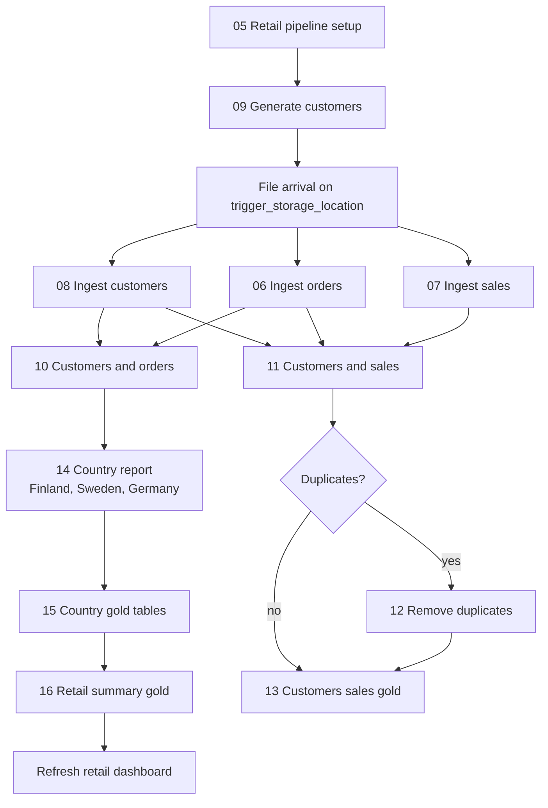

# Lakeflow job

Notebooks for the retail Lakeflow job. Run the testing flows by hand. The job itself is [`retail_ingestion_job.yml`](../retail_ingestion_job.yml), at the root of the repo. A file landing in `/Volumes/workspace/retail_pipeline/trigger_storage_location/` starts it.

The run graph, the timeline, and the pipeline diagram are in the root [README](../README.md).

## Testing flows

Notebooks in [`01_testing_flows`](01_testing_flows) are practice, not job tasks.

| Notebook | What it does |
| --- | --- |
| `01_Unity_Catalog_and_Volumes` | Lists catalogs, creates the `data_ingestion` schema, and creates the `raw_files` volume. `DESCRIBE SCHEMA` and `DESCRIBE VOLUME` show owner and location. A volume is the file side of the data lake. |
| `02_Batch_Ingestion` | Loads `orders.csv` from the `raw_files` volume into a Delta table with `CREATE TABLE AS SELECT` and `COPY INTO`. File metadata is available through `_metadata`. A second `COPY INTO` of the same file does not add those rows again. |
| `03_Merging_Schemas` | Writes two Parquet files. The older file has `id` and `name`. The newer file adds `country`. `mergeSchema` combines them, and `country` is null on the older rows. |
| `04_JSON_Kafka_Events_Ingestion` | Writes three Kafka event records as encoded bytes to `events.json`. Later tables decode them. The three JSON methods are flatten, a struct from the JSON schema with `from_json`, and a variant from `parse_json`. |
| `05_Retail_Pipeline_Setup` | Starts the retail pipeline: chooses `workspace.retail_pipeline`, loads the starting `orders` and `sales` rows, and creates the `trigger_storage_location` volume. Run this before the job. |

## Ingest and generation

Bronze tables in [`02_ingest_and_generation`](02_ingest_and_generation) are loaded in three ways.

1. **Notebook.** `06_Ingest_Orders` copies `orders` into `orders_bronze`. `08_Ingest_Customers` reads the customer CSVs into `customers_bronze`.
2. **SQL query.** `07_Ingest_Sales` is the statement that copies `sales` into `sales_bronze`. The job runs that statement as a saved SQL query.
3. **Generate, then ingest.** Run `09_Generate_Customers` first. It writes a customer CSV into the volume. Then run `08_Ingest_Customers`, which loads that file into `customers_bronze`. A new file in the volume also starts the job, and the job runs notebook 08.

| Notebook | Job task | Result |
| --- | --- | --- |
| `09_Generate_Customers` | Starts the job by writing a CSV into the volume. | `customers_<timestamp>.csv` |
| `08_Ingest_Customers` | `ingest_customers` | `customers_bronze` |
| `06_Ingest_Orders` | `ingest_orders` | `orders_bronze` |
| `07_Ingest_Sales` | `ingest_sales` uses the saved SQL query with the same statement. | `sales_bronze` |

## Logic and transformation

Notebooks in [`03_logic_and_transformation`](03_logic_and_transformation):

1. `10_Join_Customers_Orders` joins `customers_bronze` and `orders_bronze` into `customers_orders_silver`.
2. `11_Join_Customers_Sales` joins customers, orders, and sales into `customers_sales_silver`, then checks whether that result has duplicate rows.
3. `12_Remove_Duplicates` removes those duplicates from `customers_sales_silver` when the check finds them.
4. `13_Transform_Customers_Sales` cleans the joined sales table: trimmed names, typed ids and prices, plus `order_year` and `order_month`. The result is `customers_sales_gold`.
5. `14_Country_Orders_Report` filters `customers_orders_silver` by country. The job runs it once for each country: Finland, Sweden, and Germany.
6. `15_Transform_Country_Orders` applies a different transformation for each country and writes `orders_finland_gold`, `orders_sweden_gold`, and `orders_germany_gold`.
7. `16_Retail_Summary_Gold` builds `retail_summary_gold`, the summary table behind the Databricks dashboard.

| Notebook | Job task | Result |
| --- | --- | --- |
| `10_Join_Customers_Orders` | `customers_orders_report` | `customers_orders_silver` |
| `14_Country_Orders_Report` | `country_orders_iterator`, once each for Finland, Sweden, and Germany | `orders_<country>_silver` |
| `15_Transform_Country_Orders` | `transforming_country_orders` | `orders_finland_gold`, `orders_sweden_gold`, `orders_germany_gold` |
| `16_Retail_Summary_Gold` | `create_retail_summary` | `retail_summary_gold` |
| `11_Join_Customers_Sales` | `customers_sales_summary` | `customers_sales_silver`, and task value `has_duplicates` |
| `12_Remove_Duplicates` | `dropping_duplicate_records`, only when `has_duplicates` is true | Deduplicated `customers_sales_silver` |
| `13_Transform_Customers_Sales` | `transforming_customers_sales` | `customers_sales_gold` |

`checking_for_duplicates` and `refreshing_retail_dashboard` are job steps with no notebook. The condition compares `has_duplicates` to `true`. The dashboard task refreshes dashboard `01f1c59e6cd015b98da3a8656e5d5ecb` after the retail summary.

## Job flow

The three ingest tasks start together. Orders and sales then run as separate branches. `13_Transform_Customers_Sales` runs after the duplicate task when duplicates were found, and directly after the check when they were not (`run_if: NONE_FAILED`).
