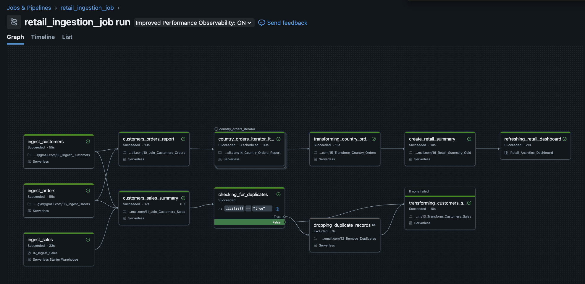
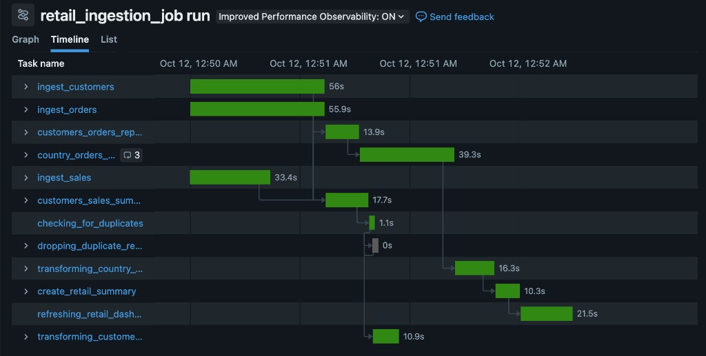
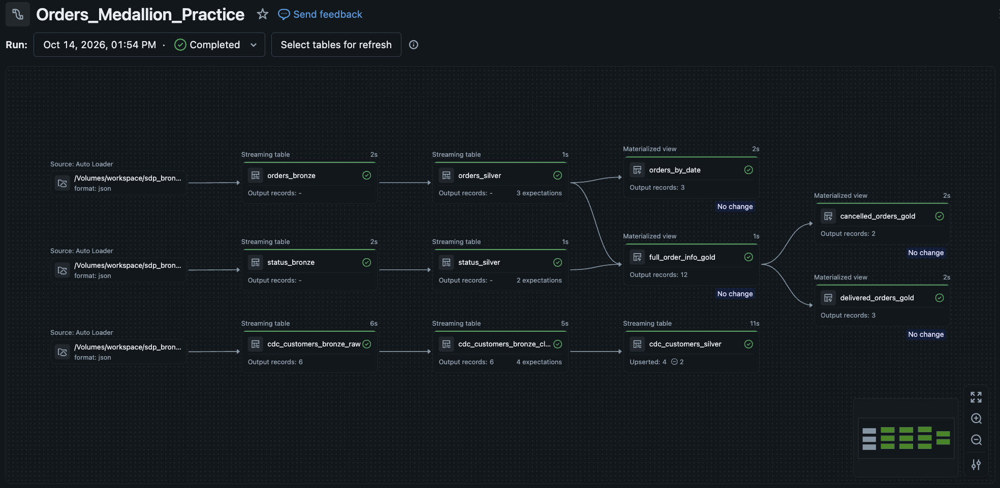

# Databricks Lakeflow

This repo holds two separate pieces of work.

[`10_Lakeflow`](10_Lakeflow) is the retail Lakeflow job and the notebooks around it. The testing flows try catalog, volume, batch, schema, and JSON patterns. The job then ingests customers, orders, and sales, joins them, and writes the silver and gold tables. Everything that belongs to that job is in this folder and in [`retail_ingestion_job.yml`](retail_ingestion_job.yml).

[`20_ETL_Pipeline`](20_ETL_Pipeline) is a medallion ETL pipeline for orders, order status, and customer change events. The setup notebook creates the schemas and source files. The pipeline code is under `Orders_Medallion_Practice`, and the pipeline definition is [`orders_etl_pipeline.yaml`](orders_etl_pipeline.yaml).

Workspace paths in both YAML files use `example@gmail.com` in place of the account email.

## Folders

| Folder | What it holds |
| --- | --- |
| [`10_Lakeflow`](10_Lakeflow) | Testing flows, bronze ingest, and the job's joins and transformations. Notebook notes are in that folder's [README](10_Lakeflow/README.md). |
| [`20_ETL_Pipeline`](20_ETL_Pipeline) | `20_SETUP_OrdersMedallionPractice` plus `orders`, `status`, and `customers` pipeline SQL. How to run it is in that folder's [README](20_ETL_Pipeline/README.md). |

## YAML files

| File | What it defines |
| --- | --- |
| [`retail_ingestion_job.yml`](retail_ingestion_job.yml) | The retail job. A file in `/Volumes/workspace/retail_pipeline/trigger_storage_location/` starts it. |
| [`orders_etl_pipeline.yaml`](orders_etl_pipeline.yaml) | The `Orders_Medallion_Practice` pipeline. It reads JSON from `/Volumes/workspace/sdp_bronze/source`. |

## Images

One run of `retail_ingestion_job`. `checking_for_duplicates` is false, so `dropping_duplicate_records` is excluded and `transforming_customers_sales` still runs. Workspace paths on the task cards are covered.

The same run on the timeline. `dropping_duplicate_records` takes 0s because it was excluded. `refreshing_retail_dashboard` runs after `create_retail_summary`.

The `Orders_Medallion_Practice` pipeline graph. Auto Loader reads JSON from the source volume into bronze streaming tables, then silver, then the gold materialized views.

