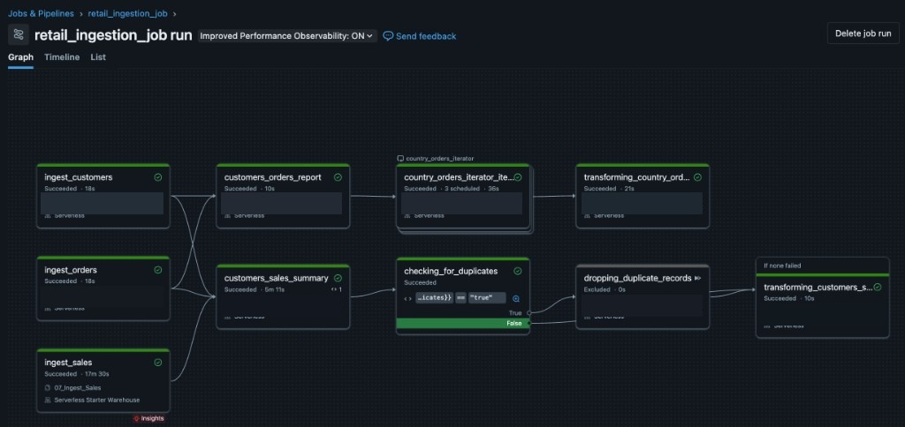
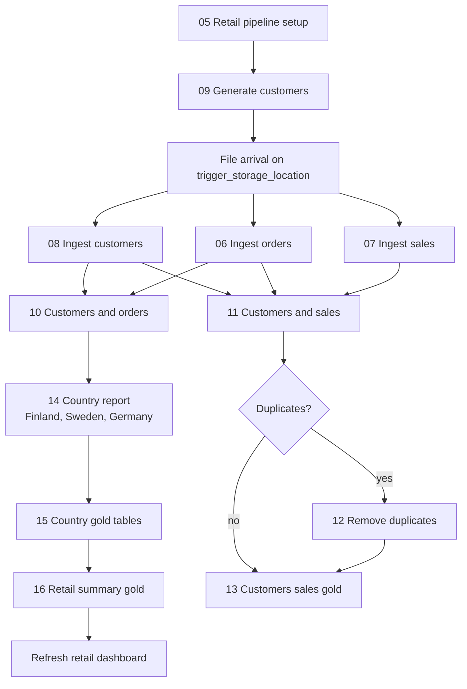

# Retail pipeline

Databricks notebooks for the retail Lakeflow job, plus the earlier notebooks used to try catalog, volume, and ingestion patterns. The job itself is [`retail_ingestion_job.yml`](retail_ingestion_job.yml). A file landing in `/Volumes/workspace/retail_pipeline/trigger_storage_location/` starts it.

Notebook paths in that file are the Databricks workspace paths (`/Workspace/Users/example@gmail.com/...`). Every occurrence of the account email is replaced with `example@gmail.com`. The folders below are the local layout.

## Folders

| Folder | What it holds |
| --- | --- |
| [`01_testing_flows`](01_testing_flows) | Notebooks run by hand to try Unity Catalog, volumes, batch loads, schema changes, JSON events, and the retail schema. |
| [`02_ingest_and_generation`](02_ingest_and_generation) | Customer file generation, and the bronze loads for customers, orders, and sales. Details are in that folder's [README](02_ingest_and_generation/README.md). |
| [`03_logic_and_transformation`](03_logic_and_transformation) | Joins, the duplicate check, country iteration, and the silver and gold tables. Details are in that folder's [README](03_logic_and_transformation/README.md). |

### Testing flows

| Notebook | What it tries |
| --- | --- |
| `01_Unity_Catalog_and_Volumes` | Catalog, schema, volume, and a sample file. |
| `02_Batch_Ingestion` | Batch copy and insert patterns. |
| `03_Merging_Schemas` | Loading files when the schema changes. |
| `04_JSON_Kafka_Events_Ingestion` | JSON event records through bronze shapes. |
| `05_Retail_Pipeline_Setup` | `workspace.retail_pipeline`, the `orders` and `sales` tables, and `trigger_storage_location`. Run this before the job. |

## Pipeline

The visualization of the whole pipeline is in this README, at the root of the project. This is one run of `retail_ingestion_job`. `checking_for_duplicates` is false, so `dropping_duplicate_records` is excluded and `transforming_customers_sales` still runs. Notebook paths are covered in the image.

The three ingest tasks start together. Orders and sales then run as separate branches. `13_Transform_Customers_Sales` runs after the duplicate task when duplicates were found, and directly after the check when they were not (`run_if: NONE_FAILED`).
